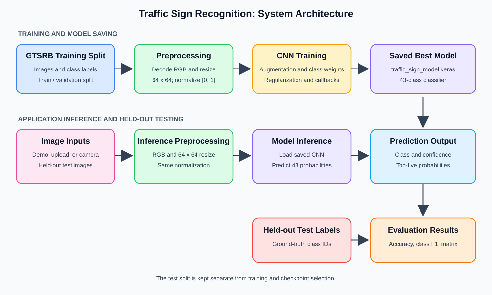
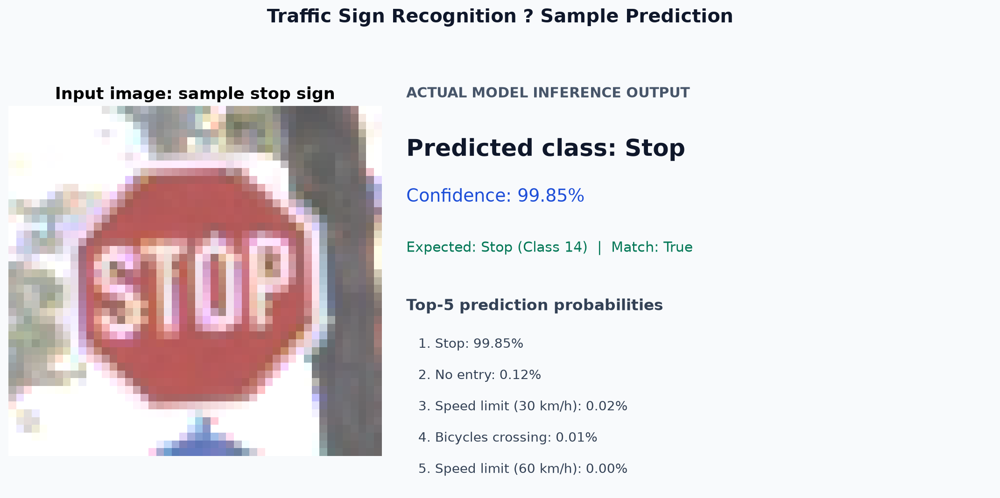
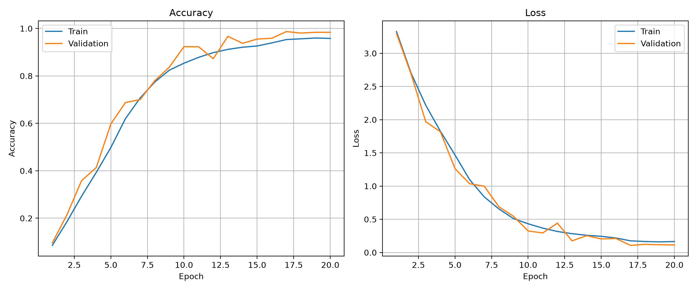
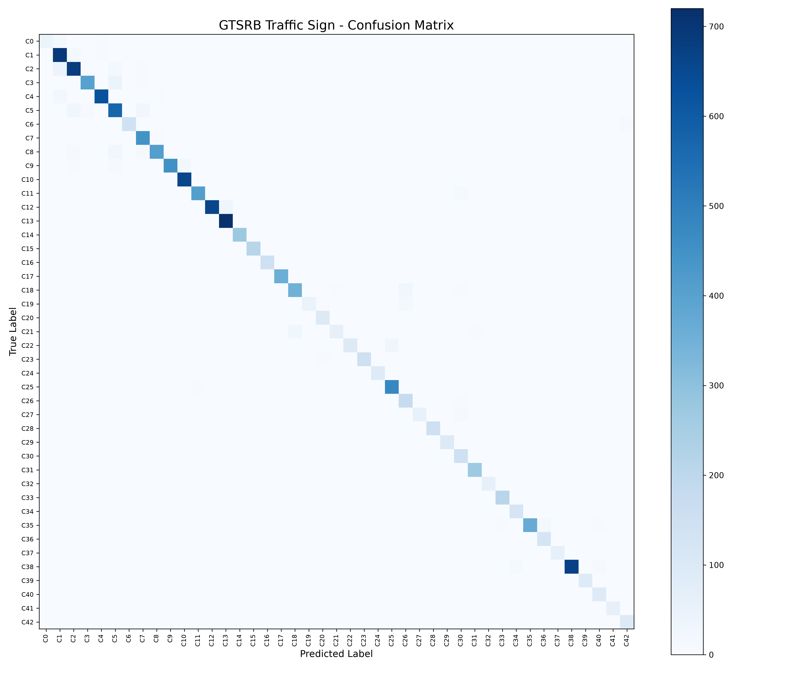

## 1. Cover Page

# CAPSTONE PROJECT REPORT

<div align="center">

### TRAFFIC SIGN RECOGNITION USING DEEP LEARNING

#### German Traffic Sign Recognition Benchmark (GTSRB)

**Student Name:** Ashish Kumar<br>
**Hall Ticket Number:** 251FD01003<br>
**Institution:** VIGNAN'S FOUNDATION FOR SCIENCE, TECHNOLOGY & RESEARCH<br>
**Academic Year:** 2025-2027

</div>

<div style="page-break-after: always;"></div>

---

## 2. Abstract

Traffic signs communicate speed limits, right-of-way rules, hazards, and required directions. This capstone project develops an image-classification system that maps an image containing one prominent traffic sign to one of the 43 categories in the German Traffic Sign Recognition Benchmark (GTSRB). The system uses a convolutional neural network (CNN) trained from scratch with 64 x 64 RGB inputs. The training pipeline uses a deterministic, class-stratified validation split, class-weighted examples, training-only image augmentation, dropout, L2 regularization, learning-rate reduction, and early stopping.

The selected model achieved **95.53% overall accuracy** and **94.97% macro F1** on the separate GTSRB test set. A Streamlit application loads the trained model and supports demo samples, image uploads, camera captures, and a catalog of the 43 classes. A check of the ten included demo samples produced the expected class for all ten; these curated samples are a functional demonstration, not an independent benchmark.

The model is a classifier, not an object detector: it does not locate signs in a complete road scene. Its labels are limited to the GTSRB classes, so results do not guarantee recognition of signs from other countries or reliable performance in every real-world condition. It is an educational project and must not be used to make driving decisions.

**Keywords:** Traffic sign recognition, image classification, CNN, TensorFlow, data augmentation, GTSRB, Streamlit.

---

## 3. Problem Statement and Objectives

### 2.1 Problem statement

Build a program that accepts an image containing a traffic sign and predicts its category. The model should learn visual features from labeled examples, generalize beyond the training images, and expose its prediction in a usable application. Similar-looking signs, differences in illumination and viewpoint, class imbalance, and small input images make this a non-trivial classification task.

### 2.2 Objectives

1. Use the GTSRB benchmark to train a 43-class traffic-sign classifier.
2. Resize and normalize images consistently for model training, evaluation, and application inference.
3. Reduce overfitting risk with training-only augmentation, class weighting, dropout, L2 regularization, and early stopping.
4. Keep a stratified validation set for model selection and reserve the separate GTSRB test set for final evaluation.
5. Measure overall accuracy and per-class precision, recall, and F1-score.
6. Build a Streamlit interface for sample-based testing, uploaded photographs, camera captures, and sign-class browsing.
7. Document the system's scope and limitations rather than claiming universal recognition or safety.

### 2.3 Scope and assumptions

- There is one prominent sign in the input image, preferably centered and cropped closely.
- The expected output is one of 43 GTSRB class labels.
- A full road-scene image is outside the intended input scope unless the sign is first cropped by a person or a separate detector.
- The classification confidence is a model score, not a guarantee that a prediction is correct.

---

## 4. Software and Hardware Requirements, Datasets

### 3.1 Software requirements

| Component | Version / requirement |
|---|---|
| Operating system used | Microsoft Windows 11 Home Single Language, 64-bit |
| Python used | Python 3.13.9 |
| Deep-learning framework | TensorFlow 2.21.0 with Keras |
| Web interface | Streamlit 1.66.1 |
| Numerical processing | NumPy 2.5.4 |
| Image processing | Pillow 13.0.0 |
| Plotting | Matplotlib 3.11.2 |
| Source control | Git; public GitHub repository |
| Web browser | Current browser for the Streamlit interface |

Install the pinned application and training dependencies from the project root:

```bash
pip install -r requirements.txt
```

The application can be started with:

```bash
streamlit run app.py
```

To train or evaluate, run the corresponding Python scripts from the project root, where the `data/` directory and model file are located.

### 3.2 Hardware requirements

**Machine used for this project**

| Component | Observed configuration |
|---|---|
| Processor | 11th Gen Intel Core i5-11400H, 6 cores / 12 logical processors |
| Memory | Approximately 8 GB RAM |
| GPU | TensorFlow did not detect a GPU; the reported training run used the CPU |
| Storage | Local disk containing the source, trained model, and extracted dataset |

**Practical requirements:** A 64-bit computer with Python 3.13, a modern CPU, approximately 8 GB RAM, and enough free storage for the project, dependencies, extracted GTSRB images, and training outputs is suitable for reproducing this run. A supported accelerator can shorten training, but no GPU is required for the saved model to perform inference. Exact training time depends on the computer and software environment.

### 3.3 Dataset

The project uses the **German Traffic Sign Recognition Benchmark (GTSRB)**, a labeled image benchmark with 43 traffic-sign classes. The project data contains CSV metadata with columns for image dimensions, ROI coordinates, class ID, and relative image path.

| Dataset portion | Images | Use |
|---|---:|---|
| GTSRB training CSV | 39,209 | Source of training and validation images |
| Training subset | 31,367 | CNN weight updates |
| Validation subset | 7,842 | Model selection and early stopping |
| Separate GTSRB test CSV | 12,630 | Final held-out evaluation |

The 39,209 training examples were divided with a deterministic, class-stratified 80:20 split (seed 42). This preserves examples from every represented class in both subsets. The test CSV was not used for fitting the model or choosing its checkpoint. The CSV has 12,630 test records; the separate extracted image folder contains one additional file not indexed by that CSV, and that unlisted file is not part of the reported evaluation.

The pipeline decodes each image in batches, converts it to RGB, resizes the **full image** to 64 x 64, and scales pixel values to `[0, 1]`. Although the CSV includes ROI coordinates, the implemented training pipeline does not crop by those coordinates. For this reason, the app instructions recommend cropping an uploaded photo to the sign.

The complete dataset archive is approximately 642 MB and is intentionally excluded from GitHub. The small demo images under `data/samples/` are included in the repository. The trained model is also included, so the demo app does not require the full training dataset.

---

## 5. System Architecture Diagram



**Figure 1.** Data flow from the GTSRB data and image preprocessing to CNN training, the saved model, the Streamlit application, and held-out test evaluation.

### 4.1 Architecture components

1. **Dataset:** Labeled GTSRB images and a separate held-out test set.
2. **Preprocessing:** RGB decoding, 64 x 64 resize, and pixel normalization.
3. **CNN:** Training-time augmentation, convolution blocks, and a 43-class softmax output.
4. **Saved model:** Best checkpoint stored as `traffic_sign_model.keras`.
5. **Streamlit application:** Receives a sample, uploaded image, or camera capture and displays class predictions.
6. **Evaluation:** Compares predicted labels with held-out test labels and produces metrics and a confusion matrix.

---

## 6. Implementation Details

### 5.1 Data loading and preprocessing

The preprocessing module reads image paths and class IDs from `Train.csv` and `Test.csv`. TensorFlow's `tf.data` pipeline reads and decodes images on demand, resizes them to 64 x 64, normalizes the image tensor, batches examples, and prefetches batches. This avoids holding all decoded images in memory at once.

The validation split is generated per class with a fixed random seed. Training examples are shuffled on each epoch. Training examples are weighted inversely by class frequency to reduce the effect of class imbalance; validation and test measurements use the original, unweighted examples.

### 5.2 Data augmentation and generalization

Augmentation layers run during training only. The model applies small random rotation, translation, zoom, brightness, and contrast changes. Horizontal flipping is deliberately disabled because it could change the meaning of directional signs. Additional generalization measures are batch normalization, dropout, L2 kernel regularization, learning-rate reduction when validation loss plateaus, and early stopping.

These techniques help limit overfitting but do not prove that the network cannot memorize examples or guarantee performance on previously unseen environments.

### 5.3 CNN model architecture

The model input is a normalized **64 x 64 x 3** RGB tensor. It produces 43 softmax class probabilities.

| Stage | Layers / operation | Output channels |
|---|---|---:|
| Input augmentation | Rotation, translation, zoom, contrast, brightness | 3 |
| Convolution block 1 | Two 3 x 3 convolutions, batch normalization, ReLU, 2 x 2 max-pooling, dropout | 24 |
| Convolution block 2 | Two 3 x 3 convolutions, batch normalization, ReLU, 2 x 2 max-pooling, dropout | 48 |
| Convolution block 3 | Two 3 x 3 convolutions, batch normalization, ReLU, 2 x 2 max-pooling, dropout | 96 |
| Feature aggregation | Global average pooling | N/A |
| Dense head | 256-unit ReLU dense layer, L2 regularization, dropout | 256 |
| Output | Softmax dense layer | 43 classes |

### 5.4 Training configuration

| Parameter | Value used |
|---|---|
| Initialization | New model trained from scratch |
| Maximum epochs in completed run | 20 |
| Batch size | 64 |
| Optimizer | AdamW |
| Initial learning rate | 0.0003 |
| Weight decay | 0.0001 |
| Loss | Sparse categorical cross-entropy |
| Training random seed | 42 |
| Model checkpoint | Best validation accuracy; selected at epoch 17 |
| Learning-rate scheduler | Reduce learning rate by 0.5 after 3 validation-loss plateaus |
| Early stopping | Validation-loss patience 8; restore best weights |

The training script supports a maximum of 30 epochs by default, but the reported saved model came from a run capped at 20 epochs. The best model checkpoint was from epoch 17, with **98.69% validation accuracy**. Validation accuracy is a model-selection result, not the final test score.

### 5.5 Application implementation

The Streamlit app provides four modes: included sample images, user image upload, camera capture, and a 43-class catalog. For image inference, the app converts the input to RGB, resizes it to the model's input dimensions, normalizes its pixel values, and calls the saved model. The page displays the predicted label, confidence score, and top-five class probabilities.

The project is published as source and model in the public repository:

[Programmer-pathak/Traffic_Sign_Detection](https://github.com/Programmer-pathak/Traffic_Sign_Detection)

The repository is published, but the Streamlit app itself has **not** been deployed to a public hosting provider. GitHub Pages does not run the Python/Streamlit application.

### 6.6 Project file index

| File / directory | Purpose |
|---|---|
| `app.py` | Streamlit interface and image inference |
| `src/preprocess.py` | Dataset records, stratified split, and batched image pipeline |
| `src/model.py` | CNN architecture and training-only augmentation |
| `src/train.py` | Training configuration, callbacks, checkpointing, and history plot |
| `src/evaluate.py` | Held-out test metrics and confusion matrix |
| `traffic_sign_model.keras` | Saved best model from the completed training run |
| `evaluation_report.json` | Overall and per-class evaluation metrics |
| `training_history.png` | Training and validation curves |
| `confusion_matrix.png` | Held-out test confusion matrix |
| `screenshots/system_architecture.svg` | System architecture diagram |
| `screenshots/sample_prediction_output.png` | Executed sample inference output |

---

## 7. Execution Screenshots with Outputs

The following figures are generated from the completed model run and project evaluation artifacts. The inference figure uses the app's RGB conversion, Pillow resize, normalization, and the saved model; it is a report visualization of the actual inference result rather than a capture of the entire browser window.

### 6.1 Sample inference output



**Figure 2.** Executed inference for the included Stop-sign sample using the saved model. The predicted class matches class 14.

Console summary from the same inference:

```text
Input: data\samples\sample_14_stop.png
Prediction: Stop | confidence=99.85% | expected=14 | match=True
```

### 6.2 Training output



**Figure 3.** Training and validation accuracy and loss across the completed 20-epoch training run. The best validation checkpoint was restored from epoch 17.

### 6.3 Test-set evaluation output



**Figure 4.** Confusion matrix produced by evaluation on the separate GTSRB test set.

The evaluation script reported:

```text
Overall Test Accuracy: 95.53%
Full evaluation report saved to evaluation_report.json
Confusion matrix plot saved as: confusion_matrix.png
```

The detailed report file contains the per-class precision, recall, F1-score, and support values.

---

## 8. Testing and Results

### 7.1 Evaluation procedure

The final model was loaded from `traffic_sign_model.keras`, then predictions were generated for all records listed in the separate `Test.csv`. Predicted labels were calculated with the highest softmax probability. Overall accuracy and per-class precision, recall, and F1-score were computed against the provided ground-truth class IDs.

### 7.2 Held-out test results

| Metric | Result |
|---|---:|
| Number of test images | 12,630 |
| Number of classes | 43 |
| Overall test accuracy | **95.53%** |
| Macro F1-score | **94.97%** |
| Best validation accuracy | 98.69% at epoch 17 |

Macro F1 is the average of the per-class F1-scores, so each class contributes equally regardless of its test-set size. The class-level results show that aggregate accuracy does not mean every class performs equally well.

| Lower-recall test class | Recall | Test support |
|---|---:|---:|
| Double curve | 63.33% | 90 |
| Speed limit (20 km/h) | 71.67% | 60 |
| Dangerous curve left | 75.00% | 60 |
| Bumpy road | 75.83% | 120 |

### 7.3 Functional checks

| Check | Observed result |
|---|---|
| Python syntax check for app and source modules | Passed |
| Model input/output shape | 64 x 64 x 3 input; 43 output classes |
| Saved model loading in Streamlit | Passed |
| Local Streamlit HTTP health check | HTTP 200 |
| Included sample-image check through app preprocessing | 10 / 10 expected class matches |
| Held-out test evaluation | 95.53% accuracy; 94.97% macro F1 |

The ten sample images are curated demo cases and should not be interpreted as a random test sample or as evidence of 100% real-world accuracy.

---

## 9. Conclusion and Future Enhancements

### 8.1 Conclusion

This project delivered a working 43-class GTSRB traffic-sign image classifier, a reproducible training and evaluation pipeline, and a Streamlit demonstration application. The final saved model uses 64 x 64 RGB inputs and generalization measures including class weighting, training-only augmentation, dropout, L2 regularization, early stopping, and best-validation checkpoint selection.

On the separate benchmark test set, the model achieved **95.53% accuracy** and **94.97% macro F1**. The app also loaded the model successfully and produced the expected result for all ten included demo samples. Per-class recall varies, and the measured benchmark performance does not guarantee correctness for arbitrary real-world images.

### 8.2 Limitations

- The system recognizes only the 43 GTSRB labels; it does not recognize every road sign worldwide or explicitly detect unknown classes.
- The model classifies the supplied image and does not locate a sign in a full road scene.
- The complete square resize can make a small sign less distinguishable. A close crop around one sign is recommended.
- Benchmark results do not establish performance under different countries, cameras, weather, distance, lighting, occlusion, or motion blur.
- Several classes have materially lower recall than the overall accuracy.
- Softmax confidence is not calibrated uncertainty and is not proof of correctness.
- The project is educational and is not a safety-certified driving system.

### 8.3 Future enhancements

1. Add and evaluate a sign-detection stage so full road scenes can be processed.
2. Test on independently collected images from different countries, cameras, weather, and lighting conditions.
3. Investigate confusion pairs and gather more representative examples for low-recall classes.
4. Add calibrated confidence thresholds and an abstain/unknown response for uncertain inputs.
5. Compare image-preserving letterbox resizing or sign-crop-based preprocessing against the current full-image resize.
6. Deploy the Streamlit application through a hosting platform such as Streamlit Community Cloud after validating platform compatibility.
7. Re-evaluate the model after any change using a held-out dataset that is not used for training or tuning.

---

## 10. References

1. J. Stallkamp, M. Schlipsing, J. Salmen, and C. Igel, "The German Traffic Sign Recognition Benchmark: A multi-class classification competition," *Proceedings of the IEEE International Joint Conference on Neural Networks (IJCNN)*, 2011, pp. 1453-1460. DOI: [10.1109/IJCNN.2011.6033395](https://doi.org/10.1109/IJCNN.2011.6033395).
2. German Traffic Sign Recognition Benchmark (GTSRB), Ruhr University Bochum, [official benchmark website](https://benchmark.ini.rub.de/gtsrb_dataset.html).
3. TensorFlow, [TensorFlow API and Keras documentation](https://www.tensorflow.org/api_docs).
4. Streamlit, [Streamlit documentation](https://docs.streamlit.io/).
5. Project source, trained model, and evaluation artifacts: [Programmer-pathak/Traffic_Sign_Detection](https://github.com/Programmer-pathak/Traffic_Sign_Detection).
